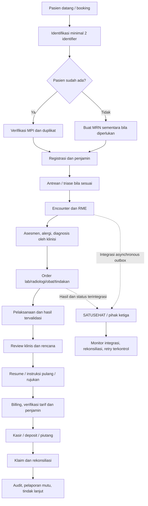
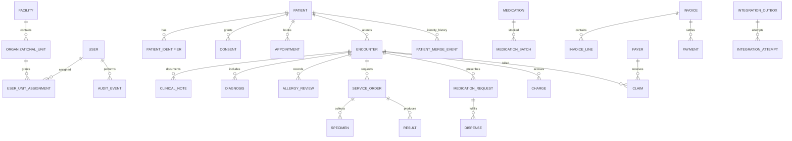
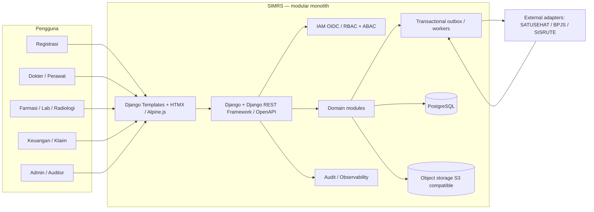

# Fase 0 — Discovery & Blueprint SIMRS

Status: **Rancangan awal — belum disetujui untuk implementasi produksi**  
Tanggal: 26 Oktober 2026  
Basis: Master Prompt Arsitek & Pembangun SIMRS dari pemilik proyek.

## 1. Ringkasan dan keputusan awal

Tujuan fase ini adalah menyepakati batas sistem, alur end-to-end, domain, NFR, kontrol keselamatan, interoperabilitas, dan urutan MVP sebelum mengubah aplikasi. Repo yang ada saat ini adalah prototipe diagnosis Python/Streamlit dengan modul RME/SATUSEHAT sandbox yang menggunakan data demo; ini bukan SIMRS lengkap. Proyek akan berkembang bertahap agar fitur AI yang ada tidak diam-diam dianggap sebagai keputusan klinis atau sumber rekam medis resmi.

### Asumsi kerja [ASUMSI]

| Area | Asumsi sementara | Dampak / konfirmasi |
|---|---|---|
| Fasilitas | Satu RS umum, satu lokasi, tipe/kelas belum diketahui | Tenant, struktur organisasi, SLA, alur rawat, serta laporan akan disesuaikan setelah tipe RS dikonfirmasi |
| Layanan MVP | Pendaftaran pasien, antrean, RME rawat jalan, order dasar, farmasi/kasir dasar | IGD/rawat inap, operasi, ICU, LIS/RIS dan klaim penuh masuk fase berikutnya |
| Penjamin | Umum + BPJS, asuransi swasta berikutnya | Tidak membuat aturan tarif/INA-CBG/iDRG hard-coded |
| Data lama | Ada atau mungkin ada data dari sistem lama | Migrasi hanya melalui mapping, profiling, rekonsiliasi dan persetujuan pemilik data |
| Deployment | Private cloud/on-premise di Indonesia, pilihan final belum diputuskan | Wajib uji konektivitas, backup, pemulihan, keamanan jaringan, dan tanggung jawab operasional |
| Stack aplikasi baru | Python 3.12+ dengan Django + Django REST Framework + drf-spectacular, PostgreSQL; Celery + Redis/RabbitMQ hanya bila kebutuhan worker terbukti; Django Templates + HTMX + Alpine.js + Tailwind sebagai default | Sesuai batasan wajib Python untuk seluruh aplikasi dan logika bisnis; modular monolith menjaga biaya operasional tetap proporsional |
| Identitas/SSO | OIDC; Keycloak dapat dievaluasi | MFA untuk aksi sensitif, tidak menyimpan password plaintext |
| Integrasi | Adapter terpisah untuk SATUSEHAT/BPJS/SISRUTE dan contract test dengan mock | Spesifikasi resmi selalu diverifikasi saat fase integrasi |
| Waktu/NFR | WIB sebagai zona awal; target awal 99,9% ketersediaan, RPO 15 menit, RTO 1 jam | Ini target usulan, bukan hasil pengukuran atau komitmen SLA |
| Penggunaan klinis | Belum boleh untuk pasien nyata | Perlu validasi klinis, uji keamanan independen, UAT, persetujuan manajemen, kesiapan operasional dan kajian regulasi |

**Bukan asumsi yang sudah terbukti:** volume tempat tidur/kunjungan, jumlah pengguna konkuren, kebutuhan multi-cabang, format sistem lama, anggaran, tanggal go-live, akses ke sandbox vendor, dan kebijakan hukum rumah sakit.

## 2. Pertanyaan prioritas untuk pemilik proyek

Jawab dengan singkat; nilai default ditampilkan supaya desain bisa maju tanpa menunggu detail lain.

1. **Identitas fasilitas:** nama RS, tipe (A/B/C/D/khusus), kelas, dan pemerintah/swasta? **Default:** RS umum swasta, kelas belum ditentukan.
2. **Skala operasi:** jumlah tempat tidur, kunjungan rawat jalan/hari dan pengguna bersamaan puncak? **Default sementara:** 100 tempat tidur, 300 kunjungan/hari, 100 pengguna konkuren—hanya untuk sizing awal, wajib diganti.
3. **Cakupan MVP dan go-live:** apakah prioritas pertama pendaftaran → RME rawat jalan → farmasi → kasir → klaim BPJS? **Default:** ya, klaim dimulai sebagai adapter/mock dan baru diaktifkan setelah kontrak resmi diuji.
4. **Sistem lama/migrasi:** ada SIMRS/RME/database/berkas yang harus dimigrasikan, dan siapa pemilik/penanggung jawab data? **Default:** migrasi belum dilakukan; lakukan profiling sampel yang sudah dianonimkan.
5. **Hosting dan pemulihan:** on-premise, private cloud, atau cloud Indonesia; apakah RS memiliki tim infrastruktur 24/7? **Default:** private cloud Indonesia, operasi dan backup wajib diuji.
6. **Stack dan repositori:** apakah setuju membangun SIMRS operasional sebagai modular monolith Python (Django + DRF + PostgreSQL), dengan prototipe Python/Streamlit diagnosis tetap dipisahkan sampai integrasi disetujui? **Default:** ya; logika bisnis seluruhnya Python dan prototipe diagnosis tidak otomatis menjadi sumber rekam medis resmi.
7. **Kesiapan tata kelola:** siapa wakil dokter, perawat, farmasi, lab, rekam medis, keuangan, keamanan, hukum, dan manajemen yang dapat memberi sign-off? **Default:** daftar peran disiapkan dahulu; fitur klinis berisiko tinggi tetap diblokir sampai validasi formal.

## 3. Alur pasien end-to-end (target)

Alur ini adalah gambaran tingkat tinggi. IGD, rawat inap (admisi-transfer-pulang/ADT), kamar operasi, ICU, alur kematian/rujukan dan downtime akan ditambahkan sebagai variasi state machine per layanan pada fase domain terkait. Data klinis/keuangan yang diposting tidak dihapus keras; koreksi menjadi amandemen berversi dan tercatat.

## 4. Cakupan modul dan prioritas MoSCoW

| Prioritas | Modul | Fase rencana |
|---|---|---|
| **Must** | IAM/RBAC, audit append-only/tamper-evident, struktur organisasi, master data, MPI/anti-duplikat, persetujuan, RME rawat jalan, Encounter, diagnosis, alergi, amandemen, signature workflow | 1–3 |
| **Must** | Tarif effective-dated, billing dasar, kasir, transaksi atomik, rekonsiliasi | 2 lalu 4 |
| **Must** | CPOE/order dasar dengan state machine; keselamatan resep dan telaah farmasi sebelum dispensing | 3 |
| **Must** | Backup/restore, downtime mode, observability, kontrol akses per unit/need-to-know, audit akses pasien | lintas fase, hardening di 7 |
| **Must** | Adapter SATUSEHAT/BPJS/SISRUTE terisolasi, mock server dan contract test; tanpa secret di repository | 5 |
| **Should** | ADT rawat inap/bed management, IGD, lab/LIS, radiologi/RIS/PACS, klaim BPJS, piutang dan asuransi | 3–4 |
| **Should** | Logistik/gudang batch & expiry/FEFO, SDM/jadwal/kredensial, akuntansi, indikator mutu | 6 |
| **Could** | Portal pasien/mobile, booking mandiri, hasil online, dashboard BI lanjutan, notifikasi multi-kanal | 6+ |
| **Won't for MVP** | Microservices tanpa alasan terukur, AI yang menetapkan diagnosis/terapi otomatis, go-live tanpa UAT/validasi dan persetujuan | Ditunda / dilarang |

## 5. Bounded context dan domain model

### Bounded context

- **Identity & Access:** user, role, permission, unit, MFA, session dan break-glass.
- **Organization & Terminology:** facility, building/ward/clinic, practitioner, service, master versi ICD-10, ICD-9-CM, LOINC, SNOMED CT dan KFA sesuai lisensi/akses dan sumber resmi.
- **MPI & Registration:** patient identity, MRN, identifier, duplicate candidate, merge/unmerge ter-audit, appointment, queue dan payer eligibility.
- **Clinical Record:** Encounter, assessment, diagnosis, allergy, note, consent, prescription/order, result, discharge/resume; dokumen signed immutable.
- **Orders & Ancillary:** ServiceRequest, specimen, lab/radiology workflow, procedure, result validation, critical-value acknowledgement.
- **Pharmacy & Inventory:** MedicationRequest, review, dispense, batch, expiry, FEFO, returns, interaction/allergy/dose guards dan high-alert/LASA.
- **ADT & Capacity:** admission, transfer, discharge, bed, ward/class, bed availability.
- **Revenue Cycle:** tariff version, charge, invoice, payment, deposit, refund, payer claim, reconciliation, AR/AP.
- **Integration Hub:** outbox/inbox, idempotency, retry/backoff, DLQ, external mapping, audit, operator reconciliation.
- **Quality & Reporting:** KPI mutu, incident, PPI, reporting datasets dengan minimum necessary access.
- **Platform & Operations:** audit chain, observability, notification, backup, downtime, migration and deployment.

### ERD konseptual (bukan DDL siap migrasi)

Pada fase implementasi, entitas perlu detail key, foreign key, uniqueness, effective dating, optimistic lock/version column, append-only event, status transition dan tenancy/facility scoping. Tidak ada migrasi basis data yang dibuat oleh dokumen ini.

## 6. Pemetaan awal ke FHIR / terminologi

Pemetaan berikut bersifat konseptual. Setiap resource, field wajib, profile, code system, extension, identifier system, bundle, dan endpoint harus diverifikasi terhadap panduan resmi SATUSEHAT yang berlaku saat fase integrasi; tidak ada jaminan kontrak produksi di fase ini.

| Domain internal | Kandidat FHIR R4 | Catatan |
|---|---|---|
| Fasilitas / unit | Organization / Location | Identifier eksternal berasal dari pemetaan terverifikasi, bukan ID lokal |
| Tenaga kesehatan | Practitioner / PractitionerRole | Kredensial dan penugasan perlu sumber berotoritas |
| Pasien / identitas | Patient | MPI lokal tetap pengendali identitas; jangan merge otomatis |
| Kunjungan | Encounter | Status internal dan mapping status harus diuji |
| Diagnosis | Condition | Kode dan display berasal dari master terminology terversi |
| Catatan/ringkasan | Composition | Dokumen final dan author/encounter harus jelas |
| Observasi | Observation | Unit, metode, waktu, status hasil dan rentang referensi tervalidasi |
| Order | ServiceRequest | State mesin internal tidak boleh disamakan sembarang dengan status eksternal |
| Spesimen / laporan | Specimen / DiagnosticReport | Proses validasi hasil terpisah dari penerimaan instrumen |
| Tindakan | Procedure | Mengikuti definisi dan terminologi resmi yang relevan |
| Obat | Medication / MedicationRequest / MedicationDispense | KFA/formularium dan safety review wajib |
| Alergi | AllergyIntolerance | Sumber dan status verifikasi alergi eksplisit |
| Catatan RME | Composition / resource terkait | Persetujuan dan aturan akses sesuai jenis konten |

Terminologi disimpan dengan versi, tanggal efektif, sumber, status aktif, catatan lisensi dan riwayat perubahan; jangan menulis aturan kode medis ke dalam logika tak terkelola. Konten dosis, interaksi, kontraindikasi, ambang kritis dan protokol klinis bertanda **[REVIEW KLINIS]**.

## 7. NFR awal dan cara membuktikannya

| NFR | Target usulan | Bukti yang harus dibuat |
|---|---|---|
| Ketersediaan | 99,9% pada jam layanan | SLI/SLO, monitoring dan laporan periode terukur |
| Pemulihan | RPO ≤ 15 menit; RTO ≤ 1 jam | Simulasi restore/failover terjadwal dengan hasil tercatat |
| API | p95 baca < 300 ms; tulis < 500 ms | Benchmark beban dengan N concurrency yang disepakati dan dataset representatif |
| Keselamatan transaksi | Tidak ada lost update; cegah double-post | Tes concurrency, optimistic locking, idempotency dan rekonsiliasi |
| Audit | Semua baca/tulis PHI ter-audit sesuai aturan, log tanpa PHI | Tes negatif/positif RBAC dan audit chain tamper detection |
| Keamanan | OWASP ASVS L2 baseline; nol temuan kritis/tinggi sebelum go-live | Threat model, SAST/SCA/DAST, pentest independen dan remediation |
| Logika kritis | Cakupan ≥80% | Coverage report untuk farmasi, billing, ADT dan klaim setelah modul tersedia |
| Operasi downtime | Pelayanan mengikuti prosedur dan rekonsiliasi | Latihan downtime dan pemulihan end-to-end |

Semua target adalah usulan; skala dan risk assessment dapat mengubahnya. Jangan menyatakan pencapaian sampai tes benar-benar dijalankan.

## 8. Matriks peran dan hak akses awal

Hak di bawah adalah prinsip minimum, bukan konfigurasi produksi final. Terapkan kombinasi RBAC + ABAC (unit, relasi perawatan, tujuan, jenis data, waktu) dan least privilege.

| Peran | Cakupan yang disarankan | Batas penting |
|---|---|---|
| Registrasi | Identitas administratif, MRN, booking dan kelayakan penjamin | Tidak otomatis dapat melihat catatan klinis sensitif |
| Dokter | RME pasien dalam hubungan perawatan, asesmen, diagnosis, order, tanda tangan | Resep/order mengikuti privilege klinis; amandemen tertaut ke versi asli |
| Perawat/bidan | Asesmen dan dokumentasi sesuai kewenangan/unit | Tidak boleh menyamar sebagai penulis dokter |
| Farmasi | Resep, alergi/interaksi yang diperlukan, dispensing dan stok | Pemisahan order, verifikasi dan dispensing sesuai kebijakan RS |
| Lab/radiologi | Order, spesimen, hasil dan validasi sesuai unit | Koreksi hasil tervalidasi berupa versi/amandemen dan notifikasi |
| Kasir/keuangan | Tarif, charge, pembayaran, refund dan klaim yang diperlukan | Tidak melihat seluruh catatan klinis tanpa alasan sah |
| Rekam medis | Kelengkapan/pelepasan dokumen sesuai kebijakan | Akses sensitif dan pengungkapan harus ter-audit |
| Auditor mutu | Data minimum yang diperlukan untuk fungsi audit | Analitik sedapat mungkin menggunakan data tersamarkan |
| Admin aplikasi | User, konfigurasi dan operasional | Administrasi teknis bukan izin otomatis melihat isi klinis |
| Petugas integrasi | Mapping, outbox, status sinkronisasi dan rekonsiliasi | Secret lewat secret manager/env; tidak memberi akses klinis luas |
| Break-glass | Akses sementara dengan alasan wajib | Notifikasi supervisor, logging dan tinjauan pasca-akses |
| Pasien | Akses pada informasi yang diizinkan setelah verifikasi identitas | Persetujuan dan representasi wali mengikuti kebijakan hukum/klinis |

Akses khusus untuk HIV, psikiatri, kekerasan, VIP dan data sangat sensitif memerlukan kebijakan dan konsultasi hukum/klinis; jangan menganggap satu role mengizinkan semua informasi.

## 9. Matriks regulasi → kontrol → pengujian (awal)

| Sumber/persyaratan | Desain fitur/kontrol | Bukti uji / status |
|---|---|---|
| PMK 24/2022 tentang Rekam Medis | RME, kerahasiaan/integritas/ketersediaan, kontrol perubahan dan akses | Tes akses, amendment, signature immutability, backup. **[VERIFIKASI]** persyaratan rinci/versi terbaru di JDIH Kemenkes |
| UU 27/2022 tentang PDP | Minimasi, purpose limitation, akses, retensi, pengelolaan insiden dan hak subjek sesuai penerapan | Threat model, uji akses/ekspor/penghapusan sesuai kewajiban. Telaah DPO/penasihat hukum |
| UU 17/2023 tentang Kesehatan dan aturan pelaksana | Tata kelola pelayanan/rekam medis, hak dan kewajiban terkait | Legal mapping dan sign-off rumah sakit. **[VERIFIKASI]** aturan turunan terkini |
| SATUSEHAT FHIR R4 | Adapter/anti-corruption layer, resource mapping, contract test, outbox/DLQ | Mock contract tests dan staging yang disetujui. **[VERIFIKASI: spesifikasi resmi terbaru]** |
| BPJS VClaim/Antrol/iCare/Aplicares dan klaim | Adapter per sistem, konfigurasi, idempotency, rekonsiliasi | Mock server/contract test dan sertifikasi/akses resmi saat tersedia. **[VERIFIKASI]** |
| ICD-10/ICD-9-CM/LOINC/SNOMED CT/KFA | Versioned terminology, lisensi/sumber dan validasi klinisi | Tes mapping, missing/retired code, effective date. **[VERIFIKASI]** |
| Akreditasi, indikator mutu, pelaporan Kemenkes/SISRUTE | Model data yang dapat ditelusuri dan export yang terkontrol | Matriks data→laporan serta uji format dan data quality. **[VERIFIKASI]** |

Retensi RME minimal 25 tahun sejak kunjungan terakhir yang disebut dalam prompt sumber **tidak dianggap final di blueprint ini**; perlu memeriksa pasal dan aturan penyimpanan/arsip yang berlaku resmi sebelum membuat kebijakan retensi.

## 10. Threat model awal (STRIDE ringkas)

| Risiko | Contoh | Kontrol mitigasi yang harus dirancang |
|---|---|---|
| Spoofing | Akun klinisi dicuri | OIDC, MFA, session management, review akun, step-up authentication untuk aksi sensitif |
| Tampering | Catatan/hasil diubah tanpa jejak | Append-only audit, hash chain, signed-document immutability, versioned amendment, DB privilege separation |
| Repudiation | Pengguna menyangkal akses atau tanda tangan | Timestamp tersinkron, actor/session/purpose log, audit integrity verification |
| Information disclosure | Petugas kasir membuka catatan psikiatri yang tidak relevan | ABAC, minimum necessary, break-glass terkontrol, masking log, encryption in transit/at rest |
| Denial of service | Gangguan jaringan/integrasi/DB | Bounded queues, timeout/circuit breaker, backup/restore, downtime procedure dan manual reconciliation |
| Elevation of privilege | Admin aplikasi memperoleh hak klinis | Pemisahan tugas, privilege review, approval dan audit akses istimewa |

Ancaman operasional/klinis tambahan: salah identitas pasien, duplikasi MRN, salah alergi/dosis, hasil kritis tak ter-acknowledge, order duplikat, stock race, double invoice/payment, mapping resource keliru, retry integrasi menggandakan resource dan kebocoran PHI melalui log. Masing-masing wajib punya tes negatif dan prosedur pemulihan pada fase modulnya.

## 11. Arsitektur C4 tingkat konteks/container

**Stack default (dapat berubah melalui ADR):** Python 3.12+; Django + Django REST Framework + drf-spectacular untuk aplikasi/API dan domain module; PostgreSQL untuk transaksi; Django Templates + HTMX + Alpine.js + Tailwind sebagai UI default; object storage untuk dokumen; OIDC provider (Keycloak dievaluasi); Celery + Redis/RabbitMQ hanya bila kebutuhan worker terukur. Logika aplikasi dan bisnis tetap Python. Python/Streamlit diagnosis tetap sebagai prototipe penelitian yang dipisahkan dan tidak menjadi sumber data klinis produksi tanpa keputusan integrasi dan validasi terpisah. Tidak ada microservice pada awal karena operasi, observability dan transaksi terdistribusi akan menambah beban.

## 12. ADR awal

### ADR-0001 — Modular monolith, bukan microservices
- **Konteks:** cakupan SIMRS luas, keselamatan klinis dan integritas transaksi lebih penting daripada pemisahan deploy dini.
- **Opsi:** monolith modular; microservices sejak awal.
- **Keputusan:** modular monolith dengan bounded context, kontrak internal dan outbox. Pisahkan service hanya setelah ada bottleneck/ownership boundary terukur.
- **Konsekuensi:** transaksi lintas domain lebih mudah dikendalikan; disiplin modul dan batas dependensi harus ditegakkan.

### ADR-0002 — Pisahkan domain internal dari FHIR/vendor API
- **Konteks:** spesifikasi SATUSEHAT/BPJS berubah dan tidak boleh menyebar ke kode klinis.
- **Opsi:** mengikat domain langsung ke resource eksternal; adapter anti-corruption layer.
- **Keputusan:** model internal canonical dengan adapter, mapping berversi, mock server dan contract test.
- **Konsekuensi:** ada biaya mapping, tetapi pergantian versi dan rekonsiliasi lebih terkendali.

### ADR-0003 — Data sintetis dan default non-produksi
- **Konteks:** repo sekarang memakai demo dan mempunyai modul prediksi yang belum tervalidasi untuk populasi lokal.
- **Opsi:** memakai data nyata untuk demo; data sintetis saja sebelum tata kelola disetujui.
- **Keputusan:** semua dev/test memakai data sintetis; jaringan eksternal nonaktif kecuali tes integrasi terkonfigurasi secara sadar.
- **Konsekuensi:** hasil demo bukan bukti klinis; diperlukan staging yang disetujui untuk uji integrasi.

### ADR-0004 — Append-only audit dan amendment untuk perubahan klinis
- **Konteks:** perubahan tanpa sejarah meningkatkan risiko keselamatan dan sengketa.
- **Opsi:** overwrite/hard delete; revisi berversi dengan pelaku/waktu/alasan.
- **Keputusan:** data klinis/keuangan yang sudah diposting tidak di-hard-delete; gunakan amendment/event correction yang teraudit.
- **Konsekuensi:** UI dan laporan harus menampilkan status versi dan koreksi, bukan menghapus riwayat.

### ADR-0005 — Stack SIMRS baru terpisah dari prototipe diagnosis
- **Konteks:** aplikasi saat ini Python/Streamlit dan fokus pada eksperimen; kebutuhan operasional SIMRS berbeda.
- **Opsi:** menambahkan seluruh modul ke prototype; gunakan stack web operasional terpisah lalu integrasikan dengan kontrak.
- **Keputusan:** modular monolith Python 3.12+ dengan Django + DRF + PostgreSQL untuk SIMRS; prototipe diagnosis tetap terisolasi sampai ada desain integrasi, validasi klinis dan persetujuan.
- **Konsekuensi:** repositori/deployment baru mungkin diperlukan; jangan menyamakan model statistik dengan diagnosis klinis.

## 13. Rencana implementasi tingkat tinggi

1. **Fase 1 — Fondasi platform:** bootstrap aplikasi, CI, secret hygiene, auth/OIDC, RBAC/ABAC baseline, audit, organisasi, terminology scaffold, MPI dan synthetic seed.
2. **Fase 2 — Front office/kasir:** registrasi, duplicate candidate, appointment/queue, payer, effective-dated tariff, invoice/payment dan tes transaksi.
3. **Fase 3 — Inti klinis:** encounter, RME, allergy review, diagnosis, consent/signature, CPOE, pharmacy, lab/radiology, IGD/ADT bertahap dengan UAT klinis.
4. **Fase 4 — Revenue cycle:** eligibility, claims adapter, reconciliation, AR/COB dan kontrak resmi.
5. **Fase 5 — Interoperabilitas/pelaporan:** SATUSEHAT, BPJS, SISRUTE dan kanal pelaporan dengan contract tests, staging dan monitoring.
6. **Fase 6 — Back office/mutu:** stok batch/expiry/FEFO, SDM, asset, accounting, quality measures/BI.
7. **Fase 7 — Hardening/go-live:** performance/security tests, UAT, migration rehearsal, parallel run, training, backup restore, downtime drills, runbook, rollback plan dan sign-off.

Estimasi belum dapat dinyatakan dalam kalender secara bertanggung jawab sebelum skala, cakupan MVP, tim dan integrasi diketahui. Alokasi kasar: discovery 1–3 minggu; fondasi 4–8; front-office 4–8; domain klinis 8–16+; integrasi/pendapatan/back-office 8–20+; hardening/go-live 4–8+ secara bertahap. Angka ini indikatif, tidak termasuk procurement, validasi vendor, migrasi kompleks dan persetujuan formal.

## 14. Kasus tepi wajib untuk backlog

- Pasien tanpa NIK / bayi baru lahir / WNA / tidak dikenal di IGD; identitas dilengkapi; candidate duplicate, merge/unmerge dengan audit.
- Bed, kelas, transfer, tarif efektif, paket dan biaya tambahan yang berubah di tengah perawatan.
- Obat racikan; expired/batch mismatch; stok minus dicegah; retur obat; koreksi sebelum/sesudah klaim.
- Order dibatalkan setelah sampel/obat/tindakan dilakukan; hasil lab dikoreksi setelah validasi dan pemberitahuan penerima.
- Pulang paksa, meninggal, rujuk keluar/masuk, observasi IGD berkepanjangan.
- Penjamin ganda/COB, kartu nonaktif, SEP/bridging gagal, pihak ketiga down.
- HIV, psikiatri, kekerasan, pasien VIP, dan akses break-glass.
- DB/network/power failure di tengah transaksi; concurrent booking/bed/stock/posting; double request/response hilang.
- Integrasi: timeout setelah POST, HTTP 5xx setelah remote commit, resource tanpa ID, mapping mismatch, outbox poison item, duplikat dan rekonsiliasi manual.

## 15. Checklist Fase 0 dan self-review

- [x] Repo aktif dan batas antara prototype diagnosis dan target SIMRS didokumentasikan.
- [x] Asumsi ditandai dan pertanyaan prioritas diajukan.
- [x] Alur pasien, bounded context, ERD konseptual dan C4 tingkat tinggi tersedia.
- [x] MoSCoW, NFR, role-access, mapping FHIR konseptual, regulatory traceability dan STRIDE tersedia.
- [x] ADR dan urutan fase dicatat.
- [ ] Spesifikasi regulasi resmi terkini diverifikasi: **belum; wajib dilakukan sebelum fase implementasi terkait**.
- [ ] Detail skala/fasilitas, keputusan stack, owner klinis, hosting, anggaran dan MVP disetujui.
- [ ] Uji klinis, security pentest, load test, UAT, pemulihan dan persetujuan go-live: belum dikerjakan.
- [ ] Belum ada kode, DDL, migrasi DB, koneksi vendor, atau klaim kesiapan produksi dalam fase dokumen ini.

### Sisa risiko
1. Konten regulasi dan integrasi pada dokumen ini adalah peta kerja, bukan opini hukum atau bukti kepatuhan. Verifikasi ke JDIH Kemenkes, peraturan.go.id/BPK, BPJS Kesehatan dan panduan SATUSEHAT resmi perlu dilakukan saat desain implementasi.
2. Diagram dan domain belum tervalidasi bersama staf klinis, farmasi, laboratorium, rekam medis, billing dan manajemen.
3. Target NFR belum diturunkan dari volume nyata, SLA vendor, topologi dan budget.
4. Python diagnosis prototype tidak divalidasi untuk diagnosis pasien dan harus tetap diberi disclaimer serta pemisahan akses sampai review terpisah.

## Cara meninjau
Baca file ini dan jawab pertanyaan di Bagian 2. Fase 1 baru dimulai setelah ada perintah eksplisit **LANJUT** dan keputusan yang memengaruhi arsitektur dicatat. Blueprint ini tidak boleh dipakai sebagai justifikasi go-live atau pemrosesan data pasien nyata.
